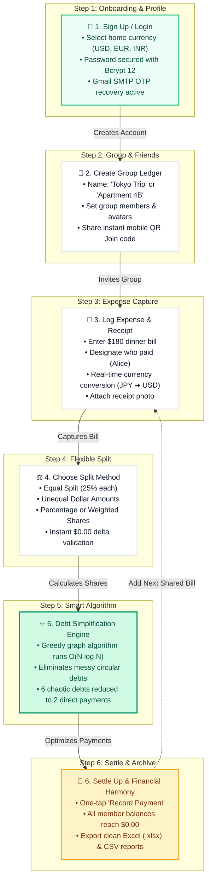

# Split Chill AI (Spill Chill)

<p align="center">
  
</p>

<h3 align="center">Intelligent Expense Splitting, Personal Finance & Financial Harmony SaaS</h3>

<p align="center">
  <a href="LICENSE"></a>
  
  
  
  
  
  
  
</p>

---

## Table of Contents

- [Overview](#overview)
- [Key Features](#key-features)
- [Customer & User Experience Workflow](#customer--user-experience-workflow)
  - [Interactive Workflow Simulator (Light Theme Web App)](#interactive-workflow-simulator-light-theme-web-app)
  - [End-to-End Customer Journey Chart](#end-to-end-customer-journey-chart)
  - [Detailed Customer Journey Stages](#detailed-customer-journey-stages)
- [Complete Technology Stack & Library Versions](#complete-technology-stack--library-versions)
  - [Backend Dependencies (Go Modules)](#backend-dependencies-go-modules)
  - [Frontend Dependencies (Node / npm)](#frontend-dependencies-node--npm)
- [Prerequisites & System Requirements](#prerequisites--system-requirements)
- [Local Installation & Development Guide](#local-installation--development-guide)
  - [Step 1: Clone the Repository](#step-1-clone-the-repository)
  - [Step 2: Install Frontend Dependencies](#step-2-install-frontend-dependencies)
  - [Step 3: Install Backend Dependencies](#step-3-install-backend-dependencies)
  - [Step 4: Configure Backend Settings](#step-4-configure-backend-settings)
  - [Step 5: Run Backend Server](#step-5-run-backend-server)
  - [Step 6: Run Frontend Development Server](#step-6-run-frontend-development-server)
  - [Step 7: Access the Application](#step-7-access-the-application)
- [How to Run and Access on Other Devices (LAN, Wi-Fi & Mobile)](#how-to-run-and-access-on-other-devices-lan-wi-fi--mobile)
  - [Architecture: Network Binding (`0.0.0.0`)](#architecture-network-binding-0000)
  - [Step 1: Find Host Machine LAN IP](#step-1-find-host-machine-lan-ip)
  - [Step 2: Configure Host Firewall](#step-2-configure-host-firewall)
  - [Step 3: Connect from Another PC or Laptop](#step-3-connect-from-another-pc-or-laptop)
  - [Step 4: Connect from Smartphone or Tablet (iOS / Android)](#step-4-connect-from-smartphone-or-tablet-ios--android)
  - [Step 5: Install as Mobile PWA (Native App Feel)](#step-5-install-as-mobile-pwa-native-app-feel)
  - [Step 6: Mobile QR Code Instant Connect](#step-6-mobile-qr-code-instant-connect)
- [Setting Up on a Completely New Computer (Fresh Install)](#setting-up-on-a-completely-new-computer-fresh-install)
  - [Windows Fresh Install](#windows-fresh-install)
  - [Linux / macOS Fresh Install](#linux--macos-fresh-install)
  - [Docker Quick Deployment](#docker-quick-deployment)
- [Configuration Reference (`splitchill-ai.ini`)](#configuration-reference-splitchill-aiini)
  - [Server & Network](#server--network)
  - [Database Setup (SQLite, MySQL, PostgreSQL)](#database-setup-sqlite-mysql-postgresql)
  - [SMTP Email & OTP Setup (Gmail / Custom SMTP)](#smtp-email--otp-setup-gmail--custom-smtp)
- [Production Build & Packaging](#production-build--packaging)
- [Troubleshooting & FAQs](#troubleshooting--faqs)
- [Translating & Localization](#translating--localization)
- [License](#license)

---

## Overview

**Split Chill AI** (also known as **Spill Chill**) is a modern, high-performance, self-hosted financial ledger and group expense tracking application. It bridges personal bookkeeping with seamless bill splitting, multi-currency conversions, automated debt simplification, and AI receipt processing.

Built with a robust **Go** microservices-style HTTP engine and an executive **Vue 3 + Vite** web client, Split Chill AI features:
- **Desktop Experience**: Crafted with Vuetify 3, Apache ECharts, and a custom Emerald Fintech design system.
- **Mobile Experience**: Built on Framework7 with full Progressive Web App (PWA) support, swipe gestures, and offline-ready service worker caching.
- **Privacy First**: Complete data ownership with local SQLite, MySQL, or PostgreSQL persistence.
- **Secure Password Reset**: Integrated SMTP Email OTP verification system.

---

## Key Features

- **Double-Entry & Multi-Account Bookkeeping**: Manage cash, bank accounts, credit cards, investments, and custom assets with two-level account hierarchies.
- **Group Expense Splitting**: Settle group bills, trips, and shared expenses effortlessly without awkward debt calculations.
- **Interactive Financial Visualizations**: Real-time asset overview, monthly income/expense trends, and comprehensive transaction analytics.
- **Event Calendar Ledger**: Calendar day-by-day views of spending, income, and scheduled recurring bills.
- **AI & MCP Ready**: Built-in support for Model Context Protocol (MCP) server endpoints allowing AI agents to interface with your financial records.
- **Enterprise Security**:
  - Two-Factor Authentication (2FA / TOTP)
  - One-Time Password (OTP) Email Verification for Password Resets
  - PIN Code & WebAuthn Application Lock
  - IP-based Login Rate Limiting & Brute Force Protection
- **Broad Data Import / Export**: Import and export CSV, OFX, QFX, QIF, IIF, Camt.053, MT940, GnuCash, Firefly III, and Beancount formats.
- **Global Ready**: Supports 17+ languages, real-time multi-currency exchange rates, and customized numeral/date formatting.

---

## Customer & User Experience Workflow

Split Chill AI delivers an intuitive, frictionless bill splitting and personal finance experience for friends, travel groups, and roommates.

### Interactive Workflow Simulator (Light Theme Web App)

Experience the complete customer journey interactively in the official **Light Theme** (matching the product design system):
- **Direct Browser URL**: [http://localhost:8081/workflow.html](http://localhost:8081/workflow.html) (or [`public/workflow.html`](file:///c:/Users/admin/Desktop/Modi/ADBMS%20Project/Split-Chill/public/workflow.html))
- **Interactive Scenarios**:
  1. **✈️ Weekend Trip to Tokyo** — Multi-currency expense splitting (USD &amp; JPY) with dinner receipts.
  2. **🏠 Apartment Roommates** — Monthly high-speed Wi-Fi &amp; electric utilities split.
  3. **🍱 Office Team Lunch** — Instant 4-way meal split with direct QR code settling.

---

### End-to-End Customer Journey Chart



---

### Detailed Customer Journey Stages

| Stage | Customer Action | System Intelligence &amp; Behavior | Result / Experience |
| :--- | :--- | :--- | :--- |
| **1. Onboarding &amp; Security** | User registers with email &amp; chooses home currency (USD, EUR, etc.). | Password hashed with Bcrypt (Cost 12); Gmail SMTP OTP verification ready on `smtp.gmail.com:587`. | Immediate dashboard access; zero complicated verification delays. |
| **2. Group Creation** | User creates a group (*"Tokyo Trip"*), selects members, and shows QR code. | Generates direct join link and dynamic QR code; opens LAN sockets on `0.0.0.0:8081`. | Friends scan with phone cameras and join the ledger in &lt;3 seconds. |
| **3. Expense Logging** | User adds $180 dinner, chooses Alice as payer, and attaches receipt photo. | Automatically fetches live exchange rates (JPY to USD) and verifies storage quota. | Real-time entry appears on both desktop and mobile screens simultaneously. |
| **4. Split Customization** | User picks split mode: Equal, by percentage, or custom amounts. | Validates total sum equals $180.00; checks for rounding fractions. | Every member sees their exact calculated share with complete transparency. |
| **5. Debt Minimizer** | Group views the *"Settlements"* tab. | Greedy graph algorithm resolves circular balances: e.g., Alice, Bob, Charlie &amp; David. | **6 complex debts collapse into only 2 direct payments**, eliminating 67% of transfers! |
| **6. Settlement &amp; Reports** | Members tap *"Settle Up"* after payment; organizer exports record. | Balances zero out with confetti animation; engine generates Microsoft Excel (.xlsx) file. | Group achieves total financial harmony with verifiable records. |

---

## Complete Technology Stack & Library Versions

### Backend Dependencies (Go Modules)

The backend runs on **Go 1.25+** (tested and fully compatible with Go 1.27+). Key dependencies defined in [`go.mod`](file:///c:/Users/admin/Desktop/Modi/ADBMS%20Project/Split-Chill/go.mod):

| Library / Module | Exact Version | Description & Purpose |
| :--- | :--- | :--- |
| `github.com/gin-gonic/gin` | `v1.11.0` | High-performance Go HTTP web framework & router |
| `xorm.io/xorm` | `v1.3.11` | Simple and powerful Go ORM library |
| `xorm.io/builder` | `v0.3.13` | SQL query builder for XORM |
| `github.com/mattn/go-sqlite3` | `v1.14.32` | SQLite3 driver for Go (CGO required) |
| `github.com/go-sql-driver/mysql` | `v1.9.3` | MySQL driver for Go |
| `github.com/lib/pq` | `v1.10.9` | Pure Go Postgres driver for database/sql |
| `github.com/golang-jwt/jwt/v5` | `v5.3.0` | JSON Web Token (JWT) implementation for authentication |
| `golang.org/x/crypto` | `v0.46.0` | Cryptographic primitives (Bcrypt password hashing) |
| `gopkg.in/mail.v2` | `v2.3.1` | SMTP client used for sending password reset OTP emails |
| `github.com/pquerna/otp` | `v1.5.0` | Two-Factor Authentication (TOTP / HOTP) engine |
| `github.com/go-co-op/gocron/v2` | `v2.18.2` | Job scheduler for recurring transactions & exchange rate sync |
| `github.com/urfave/cli/v3` | `v3.6.1` | Command-line interface builder (`splitchill-ai server run`) |
| `gopkg.in/ini.v1` | `v1.67.0` | INI configuration parser (`conf/splitchill-ai.ini`) |
| `github.com/sirupsen/logrus` | `v1.9.3` | Structured logger for Go |
| `github.com/xuri/excelize/v2` | `v2.10.0` | Read and write Microsoft Excel (XLSX) spreadsheets |
| `github.com/extrame/xls` | `v0.0.2` | Legacy Excel (XLS) parser |
| `github.com/minio/minio-go/v7` | `v7.0.97` | S3-compatible cloud object storage client |
| `github.com/gin-contrib/cache` | `v1.4.1` | Cache middleware for Gin |
| `github.com/gin-contrib/gzip` | `v1.2.5` | GZIP compression middleware for Gin |
| `github.com/go-playground/validator/v10` | `v10.28.0` | Request validation engine |
| `github.com/boombuler/barcode` | `v1.1.0` | QR Code and barcode generation (for 2FA setup) |
| `github.com/coreos/go-oidc/v3` | `v3.17.0` | OpenID Connect client implementation |
| `golang.org/x/oauth2` | `v0.34.0` | OAuth 2.0 client implementation |
| `github.com/stretchr/testify` | `v1.11.1` | Testing toolkit with assertions |

---

### Frontend Dependencies (Node / npm)

The frontend client is built with **Node.js (v20+ or v22 LTS)** and **TypeScript 5.9.3**. Dependencies from [`package.json`](file:///c:/Users/admin/Desktop/Modi/ADBMS%20Project/Split-Chill/package.json):

#### Production Dependencies (`dependencies`)

| Package Name | Exact Version | Description & Purpose |
| :--- | :--- | :--- |
| `vue` | `^3.5.25` | Vue 3 Reactive Framework (Composition API) |
| `vue-router` | `^4.6.4` | Official router for Vue 3 |
| `pinia` | `^3.0.4` | Intuitive state management store for Vue 3 |
| `vuetify` | `^3.11.3` | Material Component Framework for desktop UI |
| `@mdi/js` | `^7.4.47` | Material Design Icons SVG collection |
| `framework7` | `^9.0.2` | Mobile UI framework for iOS & Material theme |
| `framework7-vue` | `^9.0.2` | Vue 3 bindings for Framework7 |
| `framework7-icons` | `^5.0.5` | Framework7 mobile icons set |
| `echarts` | `^6.0.0` | Apache ECharts charting and visualization library |
| `vue-echarts` | `^8.0.1` | Apache ECharts wrapper component for Vue 3 |
| `@vuepic/vue-datepicker` | `^12.1.0` | Datepicker component for desktop scheduling |
| `three` | `^0.182.0` | 3D WebGL library |
| `@tresjs/core` | `^5.3.3` | Declarative Three.js for Vue 3 |
| `@tresjs/cientos` | `^5.2.5` | Collection of useful helpers for TresJS |
| `vue-i18n` | `^11.2.2` | Internationalization framework for Vue 3 |
| `axios` | `^1.13.2` | Promise based HTTP client for API requests |
| `crypto-js` | `^4.2.0` | JavaScript cryptographic algorithms |
| `moment` | `^2.30.1` | Parse, validate, and display dates and times |
| `moment-timezone` | `^0.6.0` | Timezone database calculation library |
| `leaflet` | `^1.9.4` | Mobile-friendly interactive map library |
| `swiper` | `^12.0.3` | Mobile touch slider and swipe gestures |
| `vuedraggable` | `^4.1.0` | Drag-and-drop component based on Sortable.js |
| `vue3-perfect-scrollbar` | `^2.0.0` | Smooth minimalist scrollbar wrapper |
| `clipboard` | `^2.0.11` | Copy to clipboard utility |
| `jalaali-js` | `^1.2.8` | Jalaali (Persian) calendar conversion library |
| `ua-parser-js` | `^1.0.39` | User-agent parser for device detection |
| `register-service-worker` | `^1.7.2` | PWA Service worker registration script |
| `skeleton-elements` | `^4.0.1` | Skeleton loading placeholder elements |
| `line-awesome` | `^1.3.0` | Font Awesome alternative icon font |
| `cbor-js` | `^0.1.0` | Concise Binary Object Representation (CBOR) decoder |
| `chardet` | `^2.1.1` | Character encoding detector for file imports |
| `dom7` | `^4.0.6` | Lightweight DOM manipulation library used by F7 |

#### Build & Dev Tooling (`devDependencies`)

| Package Name | Exact Version | Description & Purpose |
| :--- | :--- | :--- |
| `vite` | `^7.2.7` | Next-generation frontend build tool |
| `typescript` | `^5.9.3` | Typed superset of JavaScript |
| `sass` | `^1.96.0` | Dart Sass preprocessor for SCSS styling |
| `vue-tsc` | `^3.1.8` | Type-checking tool for Vue Single File Components |
| `@vitejs/plugin-vue` | `^6.0.3` | Official Vite plugin for Vue 3 |
| `vite-plugin-vuetify` | `^2.1.2` | Automatic Vuetify component & styles resolver |
| `vite-plugin-pwa` | `^1.2.0` | Zero-config PWA plugin for Vite |
| `eslint` | `^9.39.1` | Pluggable JavaScript and TypeScript linter |
| `eslint-plugin-vue` | `^10.6.2` | Official ESLint plugin for Vue |
| `cross-env` | `^10.1.0` | Cross-platform environment variable runner |
| `jest` | `^30.2.0` | JavaScript testing framework |
| `ts-jest` | `^29.4.6` | TypeScript preprocessor for Jest |
| `ts-node` | `^10.9.2` | TypeScript execution engine for Node.js |

---

## Prerequisites & System Requirements

Before running or building Split Chill AI, ensure your system has the following installed:

1. **Node.js**: `v20.x` or `v22.x LTS` ([Download Node.js](https://nodejs.org/))
2. **npm**: `v10.x` or higher (comes bundled with Node.js)
3. **Go**: `v1.25` or higher ([Download Go](https://golang.org/)) *(required only if compiling the backend from source code)*
4. **C Compiler (GCC)**: Required if compiling Go backend with SQLite3 support:
   - **Windows**: [MinGW-w64](https://www.mingw-w64.org/) or [TDM-GCC](https://jmeubank.github.io/tdm-gcc/)
   - **Linux**: `sudo apt install build-essential`
   - **macOS**: `xcode-select --install`
5. **Git**: For cloning the repository ([Download Git](https://git-scm.com/))

Verify your environment by running:
```bash
node -v       # Expected: v20.x.x or v22.x.x
npm -v        # Expected: 10.x.x+
go version    # Expected: go1.25.x or higher
git --version
```

---

## Local Installation & Development Guide

Follow these steps to set up and run the full project locally:

### Step 1: Clone the Repository

```bash
git clone https://github.com/Shavitjnr/Split-Chill.git
cd Split-Chill
```

### Step 2: Install Frontend Dependencies

Install all production and development packages with exact version locking:
```bash
npm install
```

### Step 3: Install Backend Dependencies

Download and verify all Go modules:
```bash
go mod download
go mod verify
```

### Step 4: Configure Backend Settings

Review and customize the main configuration file at [`conf/splitchill-ai.ini`](file:///c:/Users/admin/Desktop/Modi/ADBMS%20Project/Split-Chill/conf/splitchill-ai.ini):

- **Server Port**: `http_port = 8082` (Backend API port)
- **Host Binding**: `http_addr = 0.0.0.0` (Enables multi-device / LAN connections)
- **Secret Key**: Set a secure string under `secret_key` in `[security]` section.
- **Database**: Defaults to local SQLite (`type = sqlite3`, stored in `data/splitchill-ai.db`).
- **SMTP Mail**: Gmail credentials for OTP verification are pre-configured in `[mail]` section.

### Step 5: Run Backend Server

#### Option A: Run the Precompiled Windows Binary
```powershell
.\splitchill-ai.exe server run
```

#### Option B: Run Directly from Go Source
```bash
go run ./cmd server run
```

The Go engine will initialize the database schema in `data/splitchill-ai.db` and start listening on `0.0.0.0:8082`.

### Step 6: Run Frontend Development Server

In a new terminal window:
```bash
npm run serve
```
Vite will start the development server bound to `0.0.0.0:8081` with auto-reloading and proxying to the backend.

### Step 7: Access the Application

Open your browser to:
- **Desktop Dashboard**: [http://localhost:8081/desktop.html#/](http://localhost:8081/desktop.html#/)
- **Mobile Web App**: [http://localhost:8081/mobile.html#/](http://localhost:8081/mobile.html#/)
- **Product Landing Page**: [http://localhost:8081/landing.html](http://localhost:8081/landing.html)
- **Backend Health Check**: [http://localhost:8082/api/v1/server/status](http://localhost:8082/api/v1/server/status)

---

## How to Run and Access on Other Devices (LAN, Wi-Fi & Mobile)

Split Chill AI is built for seamless multi-device usage. You can host the server on one PC and access it simultaneously from other PCs, laptops, iPhones, iPads, and Android devices connected to the same Wi-Fi network.

### Architecture: Network Binding (`0.0.0.0`)

Both servers are already configured to accept connections from other devices on your local network:
1. **Frontend (Vite)** in `vite.config.ts`:
   ```ts
   server: {
       host: '0.0.0.0', // Listens on all IPv4 addresses
       port: 8081,
       ...
   }
   ```
2. **Backend (Go)** in `conf/splitchill-ai.ini`:
   ```ini
   [server]
   http_addr = 0.0.0.0 # Binds to all network interfaces
   http_port = 8082
   ```

### Step 1: Find Host Machine LAN IP

Find the local IPv4 address of the computer running Split Chill AI:

#### On Windows:
Open PowerShell or Command Prompt and run:
```powershell
ipconfig
```
Look for **IPv4 Address** under your active Wi-Fi or Ethernet adapter (e.g., `192.168.1.50` or `192.168.29.120`).

#### On macOS / Linux:
Open Terminal and run:
```bash
ip addr show   # Linux
# or
ifconfig       # macOS
```
Find the `inet` address (e.g., `192.168.1.50`).

### Step 2: Configure Host Firewall

Ensure incoming traffic on ports `8081` and `8082` is allowed through the host firewall.

#### On Windows:
Run PowerShell as Administrator:
```powershell
New-NetFirewallRule -DisplayName "Split Chill Frontend" -Direction Inbound -LocalPort 8081 -Protocol TCP -Action Allow
New-NetFirewallRule -DisplayName "Split Chill Backend" -Direction Inbound -LocalPort 8082 -Protocol TCP -Action Allow
```

#### On Linux (UFW):
```bash
sudo ufw allow 8081/tcp
sudo ufw allow 8082/tcp
```

### Step 3: Connect from Another PC or Laptop

On any other computer connected to the same Wi-Fi / Local Network, open Chrome, Firefox, or Edge:

- **Desktop Interface**:
  ```
  http://<HOST_IP>:8081/desktop.html#/
  ```
  *Example:* `http://192.168.1.50:8081/desktop.html#/`

### Step 4: Connect from Smartphone or Tablet (iOS / Android)

Connect your phone to the same Wi-Fi network as the host computer. Open Safari (iOS) or Chrome (Android) and navigate to:

- **Mobile Optimized Interface**:
  ```
  http://<HOST_IP>:8081/mobile.html#/
  ```
  *Example:* `http://192.168.1.50:8081/mobile.html#/`

### Step 5: Install as Mobile PWA (Native App Feel)

Split Chill AI includes full Progressive Web App (PWA) support. You can install it on your home screen to use full-screen without browser address bars:

#### On iPhone / iPad (Safari):
1. Navigate to `http://<HOST_IP>:8081/mobile.html#/`
2. Tap the **Share** button (box with upward arrow at bottom)
3. Scroll down and tap **Add to Home Screen**
4. Tap **Add** in the top right. An app icon named **Split Chill** will appear on your home screen.

#### On Android (Chrome):
1. Navigate to `http://<HOST_IP>:8081/mobile.html#/`
2. Tap the **three dots menu** (top right)
3. Tap **Install app** or **Add to Home screen**
4. Confirm installation. The app will open in full-screen standalone mode.

### Step 6: Mobile QR Code Instant Connect

From the Desktop UI at `http://<HOST_IP>:8081/desktop.html#/`:
1. Click **"Use on Mobile Device"** in the left sidebar.
2. A QR Code dialog will appear containing the mobile URL.
3. Open your smartphone's camera app, scan the code, and tap the link to open the mobile client immediately.

---

## Setting Up on a Completely New Computer (Fresh Install)

If you are cloning this project onto a new team member's computer or another device:

### Windows Fresh Install

```powershell
# 1. Clone repository
git clone https://github.com/Shavitjnr/Split-Chill.git
cd Split-Chill

# 2. Install Node dependencies
npm install

# 3. Start Backend server
.\splitchill-ai.exe server run

# 4. In a second terminal, start Frontend server
npm run serve
```

### Linux / macOS Fresh Install

```bash
# 1. Clone repository
git clone https://github.com/Shavitjnr/Split-Chill.git
cd Split-Chill

# 2. Install Node dependencies
npm install

# 3. Build & Run backend from source
go mod download
go build -o splitchill-ai ./cmd
./splitchill-ai server run

# 4. In a second terminal, start Frontend server
npm run serve
```

### Docker Quick Deployment

Split Chill AI can be deployed with a single Docker command:

```bash
docker run -d \
  --name splitchill-ai \
  -p 8082:8080 \
  -v $(pwd)/data:/app/data \
  -v $(pwd)/conf:/app/conf \
  Shavitjnr/split-chill-ai:latest
```

---

## Configuration Reference (`splitchill-ai.ini`)

The configuration file is located at [`conf/splitchill-ai.ini`](file:///c:/Users/admin/Desktop/Modi/ADBMS%20Project/Split-Chill/conf/splitchill-ai.ini).

### Server & Network

```ini
[server]
protocol = http
http_addr = 0.0.0.0          # Binds to all interfaces (required for multi-device LAN access)
http_port = 8082             # Backend port
domain = localhost           # Domain name
static_root_path = dist      # Production static assets path
enable_gzip = false          # Enable GZip compression
log_request = true           # Log HTTP requests
```

### Database Setup (SQLite, MySQL, PostgreSQL)

#### SQLite (Default & Recommended for Local/LAN):
```ini
[database]
type = sqlite3
db_path = data/splitchill-ai.db
auto_update_database = true
```

#### MySQL:
```ini
[database]
type = mysql
host = 127.0.0.1:3306
name = splitchill-ai
user = root
passwd = your_password
auto_update_database = true
```

#### PostgreSQL:
```ini
[database]
type = postgres
host = 127.0.0.1:5432
name = splitchill-ai
user = postgres
passwd = your_password
ssl_mode = disable
auto_update_database = true
```

### SMTP Email & OTP Setup (Gmail / Custom SMTP)

Split Chill AI comes configured with SMTP support for automated OTP password resets:

```ini
[mail]
enable_smtp = true
smtp_host = smtp.gmail.com:587
smtp_user = shavitdaloutra28@gmail.com
smtp_passwd = abstkydzjakhaicg       # Gmail App Password (16 characters)
smtp_skip_tls_verify = false
from_address = "Spill Chill" <shavitdaloutra28@gmail.com>
```

> **Note on Gmail App Passwords:** Standard account passwords will not work with Google SMTP. Generate an App Password in your Google Account under **Security > 2-Step Verification > App passwords**.

---

## Production Build & Packaging

To compile a standalone production build where the Go server directly serves the compiled frontend assets:

### Step 1: Build Frontend Bundle
```bash
npm run build
```
This compiles the Vue 3 application into the `dist/` directory.

### Step 2: Package with Build Scripts

#### On Windows:
```cmd
.\build.bat package -o splitchill-ai.zip
```
or with PowerShell:
```powershell
.\build.ps1 package -Output splitchill-ai.zip
```

#### On Linux / macOS:
```bash
chmod +x build.sh
./build.sh package -o splitchill-ai.tar.gz
```

All production binaries, templates, static frontend bundles, and configuration files will be bundled into a distributable archive.

---

## Troubleshooting & FAQs

### Q1: The browser shows "Unable to connect" when opening on another device.
- **Cause 1**: Host firewall is blocking port `8081` or `8082`. Run the firewall command in [Step 2](#step-2-configure-host-firewall) to permit incoming TCP traffic.
- **Cause 2**: The host computer and the other device are on different Wi-Fi networks (e.g., Guest Wi-Fi vs. Main Wi-Fi). Ensure both devices share the exact same network subnet.
- **Cause 3**: Ensure backend (`splitchill-ai.exe`) and frontend dev server (`npm run serve`) are actively running on the host machine.

### Q2: Backend outputs "secret_key is not set" warning.
- Open `conf/splitchill-ai.ini`, find `[security]`, and define a random 32+ character string under `secret_key = your_secure_random_string_here`.

### Q3: Git reports "unable to unlink ... db-wal or log" on Windows.
- SQLite locks the write-ahead log files while `splitchill-ai.exe` is running. Stop the backend process before pulling or switching git branches.

### Q4: Port 8081 or 8082 is already in use.
- Identify and terminate the process holding the port:
  ```powershell
  # Windows
  netstat -ano | findstr :8082
  taskkill /PID <PID> /F
  ```
  Or change `http_port` in `conf/splitchill-ai.ini` and `server.port` in `vite.config.ts`.

---

## Translating & Localization

Split Chill AI supports internationalization across 17+ languages. Translations can be contributed in the `src/locales/` directory.

| Tag | Language | Contributors |
| :--- | :--- | :--- |
| `de` | Deutsch | [@chrgm](https://github.com/chrgm) |
| `en` | English | / |
| `es` | Español | [@Miguelonlonlon](https://github.com/Miguelonlonlon), [@abrugues](https://github.com/abrugues), [@AndresTeller](https://github.com/AndresTeller), [@diegofercri](https://github.com/diegofercri) |
| `fr` | Français | [@brieucdlf](https://github.com/brieucdlf) |
| `it` | Italiano | [@waron97](https://github.com/waron97) |
| `ja` | 日本語 | [@tkymmm](https://github.com/tkymmm) |
| `kn` | ಕನ್ನಡ | [@Darshanbm05](https://github.com/Darshanbm05) |
| `ko` | 한국어 | [@overworks](https://github.com/overworks) |
| `nl` | Nederlands | [@automagics](https://github.com/automagics) |
| `pt-BR` | Português (Brasil) | [@thecodergus](https://github.com/thecodergus) |
| `ru` | Русский | [@artegoser](https://github.com/artegoser) |
| `sl` | Slovenščina | [@thehijacker](https://github.com/thehijacker) |
| `ta` | தமிழ் | [@hhharsha36](https://github.com/hhharsha36) |
| `th` | ไทย | [@natthavat28](https://github.com/natthavat28) |
| `tr` | Türkçe | [@aydnykn](https://github.com/aydnykn) |
| `uk` | Українська | [@nktlitvinenko](https://github.com/nktlitvinenko) |
| `vi` | Tiếng Việt | [@f97](https://github.com/f97) |
| `zh-Hans` | 中文 (简体) | / |
| `zh-Hant` | 中文 (繁體) | / |

---

## License

This project is licensed under the terms of the [MIT License](LICENSE).
All third-party libraries and licenses are cataloged in [`third-party-dependencies.json`](file:///c:/Users/admin/Desktop/Modi/ADBMS%20Project/Split-Chill/third-party-dependencies.json).
