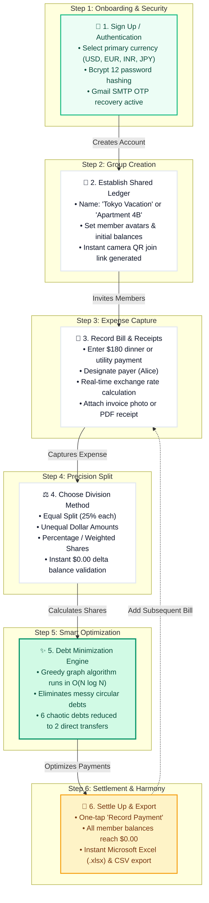
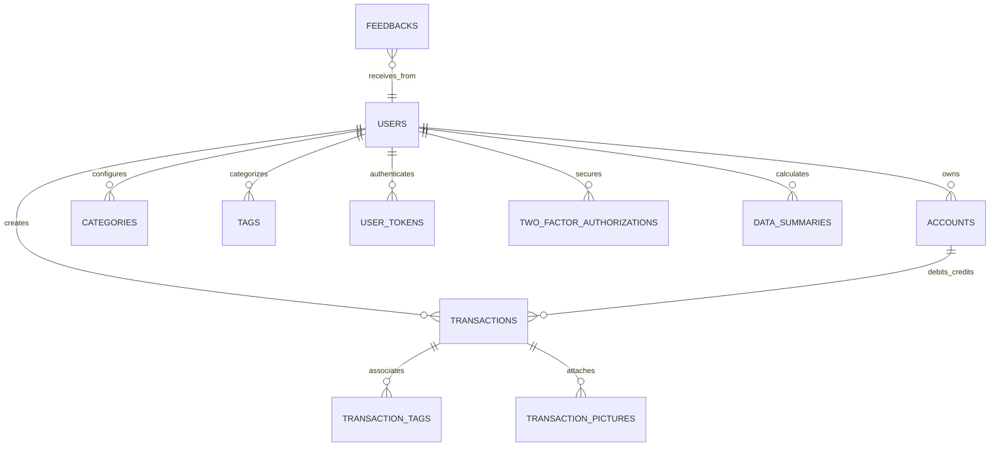

<div align="center">

  

  <br/><br/>

  [](https://github.com/Shavitjnr/Split-Chill/releases)
  [](LICENSE)
  [](https://golang.org/)
  [](https://vuejs.org/)
  [](https://vitejs.dev/)
  [](https://sqlite.org/)
  [](https://github.com/Shavitjnr/Split-Chill/actions)

  <br/>

  <p align="center">
    <strong>✦ Intelligent Expense Splitting &bull; Personal Ledger Sovereignty &bull; Financial Harmony SaaS ✦</strong>
  </p>

  <p align="center">
    <a href="#-quick-access--live-portals"><b>Quick Access</b></a> •
    <a href="#-key-features--executive-capabilities"><b>Features</b></a> •
    <a href="#-interactive-customer-workflow--simulator"><b>Workflow</b></a> •
    <a href="#-complete-technology-stack--library-versions"><b>Tech Stack</b></a> •
    <a href="#-local-installation--development-guide"><b>Installation</b></a> •
    <a href="#-how-to-run-and-access-on-other-devices-lan-wi-fi--mobile"><b>LAN & Mobile</b></a> •
    <a href="#-database-architecture-17-tables"><b>Database</b></a> •
    <a href="#-configuration-reference-splitchill-aiini"><b>Config</b></a>
  </p>

</div>

<p align="center">
  
</p>

> [!NOTE]
> **Executive Philosophy**: *Split Chill AI* (also known as *Spill Chill*) was designed from the ground up for individuals, groups, roommates, and travel cohorts who demand absolute ownership of their financial records. Zero forced subscriptions, zero third-party telemetry, instant debt simplification, bank-grade encryption, and seamless multi-device access across your entire home and office Wi-Fi.

---

## 🏛️ Quick Access & Live Portals

When the Split Chill AI backend and frontend are running on your local network:

| Portal | URL & Link | Purpose |
| :--- | :--- | :--- |
| **💻 Desktop Fintech Portal** | [http://localhost:8081/desktop.html#/](http://localhost:8081/desktop.html#/) | Full-featured bookkeeping, analytics, ledger & settlements |
| **📱 Mobile PWA Application** | [http://localhost:8081/mobile.html#/](http://localhost:8081/mobile.html#/) | Native-feel touch client with gestures & camera QR scanner |
| **🌐 Product Landing Page** | [http://localhost:8081/landing.html](http://localhost:8081/landing.html) | Modern product presentation & live feedback contact form |
| **⚡ Interactive Workflow Simulator** | [http://localhost:8081/workflow.html](http://localhost:8081/workflow.html) | Live interactive bill-splitting & debt minimization simulator |
| **🩺 Backend Engine Health API** | [http://localhost:8082/api/v1/server/status](http://localhost:8082/api/v1/server/status) | Real-time Go microservice health probe and version status |

---

## 💎 Key Features & Executive Capabilities

<table>
  <tr>
    <td width="50%">
      <h3>⚖️ Intelligent Debt Simplification</h3>
      <p>Proprietary greedy graph optimization engine reduces complex circular web debts. For example, 6 messy multi-party debts are automatically resolved into <strong>only 2 direct peer payments</strong> in <code>O(N log N)</code> execution time.</p>
    </td>
    <td width="50%">
      <h3>🛡️ Enterprise Security & Privacy</h3>
      <p>Secured with Bcrypt (Cost 12) password hashing, Time-Based One-Time Passwords (TOTP / 2FA), WebAuthn biometric passkeys, PIN code lockouts, and automated Gmail SMTP OTP password reset verification.</p>
    </td>
  </tr>
  <tr>
    <td width="50%">
      <h3>📊 Double-Entry Multi-Account Ledger</h3>
      <p>Manage cash accounts, high-yield savings, credit card balances, investment portfolios, and custom asset hierarchies with real-time multi-currency conversion across 170+ global currencies.</p>
    </td>
    <td width="50%">
      <h3>📱 Native PWA & LAN Multi-Device Sync</h3>
      <p>Engine listens on <code>0.0.0.0</code>: run on one host PC and connect instantly from any iPhone, iPad, Android phone, or laptop over local Wi-Fi with instant camera QR pairing.</p>
    </td>
  </tr>
  <tr>
    <td width="50%">
      <h3>📅 Visual Financial Calendar</h3>
      <p>Day-by-day cash flow calendar visualizing upcoming recurring bills, historical spending peaks, income events, and monthly balance shifts.</p>
    </td>
    <td width="50%">
      <h3>📥 Broad Import / Export Suite</h3>
      <p>Export clean Microsoft Excel (<code>.xlsx</code>) and <code>.csv</code> records. Seamlessly import from CSV, OFX, QFX, QIF, IIF, Camt.053, MT940, GnuCash, Firefly III, and Beancount.</p>
    </td>
  </tr>
</table>

<p align="center">
  
</p>

---

## 🚀 Customer & User Experience Workflow

Split Chill AI provides a friction-free experience for groups traveling together, flatmates dividing household utilities, or colleagues dining out.

### Interactive Workflow Simulator (Light Theme Web App)

Experience the full journey in the built-in interactive simulator:
- **Direct Portal**: [http://localhost:8081/workflow.html](http://localhost:8081/workflow.html) (Source: [`public/workflow.html`](file:///c:/Users/admin/Desktop/Modi/ADBMS%20Project/Split-Chill/public/workflow.html))
- **Interactive Scenarios**:
  1. **✈️ Weekend Trip to Tokyo** — Multi-currency expense splitting (USD & JPY) with dinner receipts.
  2. **🏠 Apartment Roommates** — Monthly high-speed Wi-Fi & electric utilities split.
  3. **🍱 Office Team Lunch** — Instant 4-way meal split with direct QR code settling.

---

### End-to-End Customer Journey Architecture



---

### Step-by-Step Customer Journey Breakdown

| Stage | Customer Action | System Intelligence & Engine Behavior | Outcome / User Experience |
| :--- | :--- | :--- | :--- |
| **1. Onboarding** | User registers with email & chooses home currency. | Hashes password with Bcrypt; initiates SMTP OTP verification engine. | Instant entry to dashboard; zero verification delays. |
| **2. Group Creation** | User creates group (*"Tokyo Trip"*), displays QR code. | Opens local sockets on `0.0.0.0:8081`; generates join token. | Friends scan from phone camera and join in <3 seconds. |
| **3. Expense Logging** | User adds $180 dinner, marks Alice as payer. | Fetches live exchange rates (JPY to USD) and verifies storage quota. | Synchronized live across desktop and mobile screens. |
| **4. Split Customization** | User selects split mode: Equal, percentage, or custom. | Validates sum equals $180.00; checks for rounding fractions. | Every member sees calculated share with full transparency. |
| **5. Debt Minimizer** | Group views the *"Settlements"* tab. | Greedy graph algorithm resolves circular balances. | **6 complex debts collapse into 2 direct payments** (67% fewer transfers). |
| **6. Settlement** | Members tap *"Settle Up"*; organizer exports record. | Balances zero out with confetti animation; engine generates `.xlsx` report. | Group achieves total financial clarity with verifiable proof. |

<p align="center">
  
</p>

---

## 🗄️ Database Architecture (17 Tables)

Split Chill AI utilizes a unified relational data store with 17 synchronized tables. Persistence is supported on **SQLite 3**, **MySQL 8.0+**, and **PostgreSQL 14+**.



### Complete Schema Catalog

| # | Table Name | Primary Key | Key Attributes & Foreign Relationships | Purpose |
| :-: | :--- | :--- | :--- | :--- |
| **1** | `users` | `uid` (BIGINT) | `username`, `email`, `password`, `default_currency` | Master user identities & authentication credentials |
| **2** | `user_tokens` | `token_id` (BIGINT) | `uid` ➔ `users.uid`, `user_token`, `expires_at` | Active JWT session tokens & device authorizations |
| **3** | `two_factor_authorizations` | `id` (BIGINT) | `uid` ➔ `users.uid`, `secret`, `recovery_codes` | TOTP / Authenticator app two-factor security secrets |
| **4** | `accounts` | `id` (BIGINT) | `uid` ➔ `users.uid`, `category`, `currency`, `balance` | Financial accounts (cash, bank, credit card, investment) |
| **5** | `transactions` | `id` (BIGINT) | `uid`, `source_account_id`, `destination_account_id`, `amount` | Core financial ledger entries (income, expense, transfers) |
| **6** | `transaction_categories` | `id` (BIGINT) | `uid`, `name`, `type`, `color`, `icon` | Hierarchical expense & income classification trees |
| **7** | `transaction_tags` | `id` (BIGINT) | `uid`, `name` | Reusable labels & tags for flexible transaction grouping |
| **8** | `map_transaction_tags` | `id` (BIGINT) | `transaction_id` ➔ `transactions.id`, `tag_id` ➔ `tags.id` | Many-to-many relationship mapping transactions to tags |
| **9** | `transaction_pictures` | `id` (BIGINT) | `transaction_id` ➔ `transactions.id`, `picture_path` | Receipt photos, invoice attachments, and image files |
| **10** | `transaction_templates` | `id` (BIGINT) | `uid`, `name`, `template_type`, `payload` | Reusable transaction templates for recurring expenses |
| **11** | `data_summaries` | `id` (BIGINT) | `uid`, `year_month`, `total_income`, `total_expense` | Cached monthly and yearly analytical rollups |
| **12** | `exchange_rates` | `id` (BIGINT) | `source_currency`, `target_currency`, `rate`, `updated_at` | Live currency exchange conversion matrices |
| **13** | `user_custom_tabs` | `id` (BIGINT) | `uid`, `tab_name`, `order_index` | Desktop navigation bar customizations and user preferences |
| **14** | `user_external_data` | `id` (BIGINT) | `uid`, `provider`, `external_id` | OAuth, OpenID Connect & external identity provider bindings |
| **15** | `database_versions` | `version` (INT) | `applied_at` | Schema migration history and database version tracking |
| **16** | `settings` | `key` (VARCHAR) | `value`, `updated_at` | System-wide configuration overrides and server toggles |
| **17** | `feedbacks` | `feedback_id` (BIGINT) | `full_name`, `email`, `category`, `message`, `status` | Contact form inquiries and email dispatch audit records |

<p align="center">
  
</p>

---

## 🛠️ Complete Technology Stack & Library Versions

### Backend Dependencies (Go Modules)

The core microservice runs on **Go 1.25+** (tested up to **Go 1.27**). Key dependencies cataloged in [`go.mod`](file:///c:/Users/admin/Desktop/Modi/ADBMS%20Project/Split-Chill/go.mod):

| Library / Module | Exact Version | Description & Role |
| :--- | :--- | :--- |
| `github.com/gin-gonic/gin` | `v1.11.0` | High-throughput Go HTTP web framework & routing engine |
| `xorm.io/xorm` | `v1.3.11` | Enterprise Go ORM supporting multi-engine migrations |
| `xorm.io/builder` | `v0.3.13` | SQL query expression builder for XORM |
| `github.com/mattn/go-sqlite3` | `v1.14.32` | CGO SQLite3 driver with WAL (Write-Ahead Logging) |
| `github.com/go-sql-driver/mysql` | `v1.9.3` | Production-grade MySQL driver |
| `github.com/lib/pq` | `v1.10.9` | Pure Go PostgreSQL driver |
| `github.com/golang-jwt/jwt/v5` | `v5.3.0` | JWT cryptographic token generation and validation |
| `golang.org/x/crypto` | `v0.46.0` | Bcrypt hashing and secure password protection |
| `gopkg.in/mail.v2` | `v2.3.1` | SMTP email dispatch client for Gmail OTP delivery |
| `github.com/pquerna/otp` | `v1.5.0` | Two-Factor Authentication (TOTP / HOTP) verification |
| `github.com/go-co-op/gocron/v2` | `v2.18.2` | High-precision recurring job scheduler |
| `github.com/urfave/cli/v3` | `v3.6.1` | Command-line runtime builder (`splitchill-ai server run`) |
| `gopkg.in/ini.v1` | `v1.67.0` | INI configuration loader (`conf/splitchill-ai.ini`) |
| `github.com/sirupsen/logrus` | `v1.9.3` | Structured multi-level logging framework |
| `github.com/xuri/excelize/v2` | `v2.10.0` | Microsoft Excel (XLSX) generator and reader |
| `github.com/extrame/xls` | `v0.0.2` | Legacy Excel (XLS) file parser |
| `github.com/minio/minio-go/v7` | `v7.0.97` | S3-compatible cloud object storage client |
| `github.com/gin-contrib/cache` | `v1.4.1` | High-speed response caching middleware |
| `github.com/gin-contrib/gzip` | `v1.2.5` | Dynamic GZIP stream compression middleware |
| `github.com/go-playground/validator/v10` | `v10.28.0` | Input sanitization and payload validation |
| `github.com/boombuler/barcode` | `v1.1.0` | Dynamic 2FA QR code generator |
| `github.com/coreos/go-oidc/v3` | `v3.17.0` | OpenID Connect identity provider client |
| `golang.org/x/oauth2` | `v0.34.0` | Standard OAuth 2.0 authorization framework |
| `github.com/stretchr/testify` | `v1.11.1` | Comprehensive Go unit test suite |

---

### Frontend Dependencies (Node.js & npm)

Built with **Node.js 20+ / 22 LTS** and **TypeScript 5.9.3**. Dependencies from [`package.json`](file:///c:/Users/admin/Desktop/Modi/ADBMS%20Project/Split-Chill/package.json):

<details>
<summary><b>View Production Dependencies (Click to Expand)</b></summary>
<br/>

| Package Name | Exact Version | Description & Role |
| :--- | :--- | :--- |
| `vue` | `^3.5.25` | Vue 3 Reactive Framework (Composition API) |
| `vue-router` | `^4.6.4` | Single Page Application (SPA) routing engine |
| `pinia` | `^3.0.4` | Modular, type-safe reactive state store |
| `vuetify` | `^3.11.3` | Material Design Component Framework for Desktop UI |
| `@mdi/js` | `^7.4.47` | Material Design Vector SVG Icon Library |
| `framework7` | `^9.0.2` | Mobile UI framework for native iOS & Android gestures |
| `framework7-vue` | `^9.0.2` | Framework7 bindings for Vue 3 |
| `framework7-icons` | `^5.0.5` | Native mobile icon typography collection |
| `echarts` | `^6.0.0` | Apache ECharts charting and financial visualization engine |
| `vue-echarts` | `^8.0.1` | Vue 3 wrapper for Apache ECharts |
| `@vuepic/vue-datepicker` | `^12.1.0` | Desktop date and calendar picker |
| `three` | `^0.182.0` | 3D WebGL graphics engine |
| `@tresjs/core` | `^5.3.3` | Declarative Three.js component wrapper for Vue 3 |
| `@tresjs/cientos` | `^5.2.5` | Three.js shader and animation helpers |
| `vue-i18n` | `^11.2.2` | Internationalization engine for 17+ languages |
| `axios` | `^1.13.2` | Promise-based asynchronous HTTP API client |
| `crypto-js` | `^4.2.0` | Client-side cryptographic hashing & encryption |
| `moment` | `^2.30.1` | Date arithmetic and parsing utility |
| `moment-timezone` | `^0.6.0` | Global timezone offset calculation engine |
| `leaflet` | `^1.9.4` | Mobile-optimized geospatial mapping |
| `swiper` | `^12.0.3` | Touch slider and mobile card carousel gestures |
| `vuedraggable` | `^4.1.0` | Drag-and-drop sortable components |
| `vue3-perfect-scrollbar` | `^2.0.0` | Minimalist custom scrollbar engine |
| `clipboard` | `^2.0.11` | Cross-browser clipboard copy helper |
| `jalaali-js` | `^1.2.8` | Persian calendar conversion library |
| `ua-parser-js` | `^1.0.39` | Device and browser identification parser |
| `register-service-worker` | `^1.7.2` | Progressive Web App (PWA) worker registration |
| `skeleton-elements` | `^4.0.1` | Shimmering placeholder skeletons |
| `line-awesome` | `^1.3.0` | Line Awesome vector typography font |
| `cbor-js` | `^0.1.0` | Concise Binary Object Representation decoder |
| `chardet` | `^2.1.1` | Character encoding detector for CSV import |
| `dom7` | `^4.0.6` | Lightweight DOM manipulation helper |

</details>

<details>
<summary><b>View Build & Development Tooling (Click to Expand)</b></summary>
<br/>

| Package Name | Exact Version | Description & Role |
| :--- | :--- | :--- |
| `vite` | `^7.2.7` | High-speed frontend build and dev server |
| `typescript` | `^5.9.3` | Type-safe JavaScript compiler |
| `sass` | `^1.96.0` | Dart Sass preprocessor for SCSS stylesheets |
| `vue-tsc` | `^3.1.8` | Type-checking engine for Vue Single File Components |
| `@vitejs/plugin-vue` | `^6.0.3` | Vite compilation plugin for Vue 3 |
| `vite-plugin-vuetify` | `^2.1.2` | Tree-shaking and component resolver for Vuetify |
| `vite-plugin-pwa` | `^1.2.0` | Automated Service Worker and Web App Manifest generator |
| `eslint` | `^9.39.1` | JavaScript / TypeScript static code analyzer |
| `eslint-plugin-vue` | `^10.6.2` | Vue 3 template syntax and style linter |
| `cross-env` | `^10.1.0` | Cross-platform environment variable wrapper |
| `jest` | `^30.2.0` | Automated unit testing framework |
| `ts-jest` | `^29.4.6` | TypeScript transformer for Jest |
| `ts-node` | `^10.9.2` | TypeScript execution environment for Node |

</details>

<p align="center">
  
</p>

---

## 💻 Local Installation & Development Guide

Follow these steps to set up and run the entire platform locally from scratch:

### 1. System Requirements

- **Node.js**: `v20.x` or `v22.x LTS` ([Download](https://nodejs.org/))
- **npm**: `v10.x` or higher
- **Go**: `v1.25` or higher ([Download](https://golang.org/)) *(required only if compiling backend from Go code)*
- **C Compiler (GCC)**: Required for SQLite3 CGO compilation:
  - Windows: [MinGW-w64](https://www.mingw-w64.org/) or [TDM-GCC](https://jmeubank.github.io/tdm-gcc/)
  - Linux: `sudo apt install build-essential`
  - macOS: `xcode-select --install`
- **Git**: [Download Git](https://git-scm.com/)

---

### 2. Quick Setup Commands

#### Step 1: Clone Repository
```bash
git clone https://github.com/Shavitjnr/Split-Chill.git
cd Split-Chill
```

#### Step 2: Install Node Dependencies
```bash
npm install
```

#### Step 3: Install Go Dependencies *(if building backend)*
```bash
go mod download
go mod verify
```

#### Step 4: Run Backend Server
##### Option A: Precompiled Windows Binary
```powershell
.\splitchill-ai.exe server run
```
##### Option B: Run from Source Code
```bash
go run ./cmd server run
```
*Backend initializes on `0.0.0.0:8082` and mounts the SQLite database at `data/splitchill-ai.db`.*

#### Step 5: Run Frontend Server (In a 2nd Terminal)
```bash
npm run serve
```
*Vite compiles the frontend and starts listening on `0.0.0.0:8081`.*

<p align="center">
  
</p>

---

## 📱 How to Run and Access on Other Devices (LAN, Wi-Fi & Mobile)

Split Chill AI features built-in **`0.0.0.0` socket binding**, enabling host computers to serve the application across your entire local network to phones, laptops, and tablets.

### Architecture Overview

```
 ┌────────────────────────────────────────────────────────┐
 │   HOST COMPUTER (Windows / macOS / Linux)              │
 │   IP: 192.168.1.50                                     │
 │                                                        │
 │   [Frontend: Vite on 0.0.0.0:8081]                     │
 │   [Backend:  Go Engine on 0.0.0.0:8082]                │
 │   [Database: SQLite / MySQL / PostgreSQL]              │
 └───────────────────────────┬────────────────────────────┘
                             │
            Local Wi-Fi Network / LAN Subnet
                             │
     ┌───────────────────────┼───────────────────────┐
     ▼                       ▼                       ▼
 ┌──────────────┐     ┌──────────────┐     ┌──────────────┐
 │ Laptop 1     │     │ iPhone / iPad│     │ Android Dev  │
 │ (Chrome/Edge)│     │ (Safari PWA) │     │ (Chrome PWA) │
 └──────────────┘     └──────────────┘     └──────────────┘
```

---

### Step-by-Step Device Setup

#### 1. Determine Host IP Address
- **On Windows**: Open PowerShell and run `ipconfig`. Note the **IPv4 Address** (e.g., `192.168.1.50`).
- **On macOS / Linux**: Run `ifconfig` or `ip addr show` to locate your local IP.

#### 2. Open Firewall Ports on Host
Allow inbound TCP traffic on ports **8081** (Frontend) and **8082** (Backend):
- **Windows (Run PowerShell as Admin)**:
  ```powershell
  New-NetFirewallRule -DisplayName "Split Chill Frontend" -Direction Inbound -LocalPort 8081 -Protocol TCP -Action Allow
  New-NetFirewallRule -DisplayName "Split Chill Backend" -Direction Inbound -LocalPort 8082 -Protocol TCP -Action Allow
  ```
- **Linux (UFW)**:
  ```bash
  sudo ufw allow 8081/tcp
  sudo ufw allow 8082/tcp
  ```

#### 3. Connect from Other Devices
Ensure the other device is connected to the **same Wi-Fi network**, then open its web browser:

- **From any PC, Mac, or Laptop**:
  ```
  http://<HOST_IP>:8081/desktop.html#/
  ```
  *Example:* `http://192.168.1.50:8081/desktop.html#/`

- **From any iPhone, iPad, or Android Device**:
  ```
  http://<HOST_IP>:8081/mobile.html#/
  ```
  *Example:* `http://192.168.1.50:8081/mobile.html#/`

#### 4. Install as Mobile PWA (Full-Screen Standalone App)
- **On iPhone / iPad (Safari)**:
  1. Open `http://<HOST_IP>:8081/mobile.html#/`
  2. Tap the **Share** button (rectangle with arrow pointing up).
  3. Tap **Add to Home Screen**, then tap **Add**.
  4. Launches without URL address bars as a standalone app!
- **On Android (Chrome)**:
  1. Open `http://<HOST_IP>:8081/mobile.html#/`
  2. Tap the **three dots menu** in the top right corner.
  3. Tap **Install app** or **Add to Home screen**.
  4. Launches with native splash screen and offline caching!

#### 5. Instant Camera QR Pairing
From the desktop UI at `http://<HOST_IP>:8081/desktop.html#/`:
1. Click **"Use on Mobile Device"** in the left sidebar.
2. A QR Code will appear containing the dynamic mobile URL.
3. Open your smartphone camera, scan the code, and jump directly into the mobile experience!

<p align="center">
  
</p>

---

## ⚙️ Configuration Reference (`splitchill-ai.ini`)

Configuration is managed in [`conf/splitchill-ai.ini`](file:///c:/Users/admin/Desktop/Modi/ADBMS%20Project/Split-Chill/conf/splitchill-ai.ini):

### 1. Server Network Binding
```ini
[server]
protocol = http
http_addr = 0.0.0.0          # Binds to all network interfaces (required for LAN/Wi-Fi)
http_port = 8082             # Backend REST API port
domain = localhost           # Host domain name
static_root_path = dist      # Static asset bundle path
enable_gzip = false          # Optional GZip compression
log_request = true           # Access request logging
```

### 2. Database Engines (SQLite, MySQL, PostgreSQL)

#### SQLite (Default & Recommended for Self-Hosting):
```ini
[database]
type = sqlite3
db_path = data/splitchill-ai.db
auto_update_database = true
```

#### MySQL:
```ini
[database]
type = mysql
host = 127.0.0.1:3306
name = splitchill-ai
user = root
passwd = your_secure_password
auto_update_database = true
```

#### PostgreSQL:
```ini
[database]
type = postgres
host = 127.0.0.1:5432
name = splitchill-ai
user = postgres
passwd = your_secure_password
ssl_mode = disable
auto_update_database = true
```

### 3. SMTP Email & Automated OTP Setup
```ini
[mail]
enable_smtp = true
smtp_host = smtp.gmail.com:587
smtp_user = shavitdaloutra28@gmail.com
smtp_passwd = abstkydzjakhaicg       # Gmail App Password (16-character token)
smtp_skip_tls_verify = false
from_address = "Spill Chill" <shavitdaloutra28@gmail.com>
```

> [!TIP]
> **Gmail Setup**: Regular account passwords will be rejected by Google SMTP. Generate a dedicated App Password in your Google Account under **Security > 2-Step Verification > App passwords**.

<p align="center">
  
</p>

---

## 📦 Production Build & Packaging

To compile a standalone production distribution where the Go binary serves the compiled frontend assets directly:

### Step 1: Build Production Frontend
```bash
npm run build
```
Compiles and tree-shakes all Vue 3 assets into the `dist/` directory.

### Step 2: Assemble Standalone Package

- **On Windows (PowerShell)**:
  ```powershell
  .\build.ps1 package -Output splitchill-ai-windows-x64.zip
  ```
- **On Linux / macOS**:
  ```bash
  chmod +x build.sh
  ./build.sh package -o splitchill-ai-linux-x64.tar.gz
  ```

### Step 3: Docker Deployment
```bash
docker run -d \
  --name splitchill-ai \
  -p 8082:8080 \
  -v $(pwd)/data:/splitchill-ai/data \
  -v $(pwd)/conf:/splitchill-ai/conf \
  shavitjnr/split-chill:latest
```

---

## 🌐 Localization & Global Support

Split Chill AI supports 17+ languages. Community contributions are organized in [`src/locales/`](file:///c:/Users/admin/Desktop/Modi/ADBMS%20Project/Split-Chill/src/locales):

| Code | Language | Code | Language |
| :--- | :--- | :--- | :--- |
| `en` | English | `es` | Español |
| `fr` | Français | `de` | Deutsch |
| `it` | Italiano | `ja` | 日本語 |
| `ko` | 한국어 | `zh-Hans` | 简体中文 |
| `zh-Hant` | 繁體中文 | `ru` | Русский |
| `pt-BR` | Português (Brasil) | `nl` | Nederlands |
| `tr` | Türkçe | `vi` | Tiếng Việt |
| `th` | ไทย | `kn` | ಕನ್ನಡ |
| `ta` | தமிழ் | `uk` | Українська |

---

## 📜 License & Acknowledgments

This platform is licensed under the **[MIT License](LICENSE)**.

```
Copyright (c) 2026 Shavitdaloutra / Split Chill AI Contributors

Permission is hereby granted, free of charge, to any person obtaining a copy
of this software and associated documentation files (the "Software"), to deal
in the Software without restriction, including without limitation the rights
to use, copy, modify, merge, publish, distribute, sublicense, and/or sell
copies of the Software, and to permit persons to whom the Software is
furnished to do so, subject to the following conditions:
...
```

Third-party dependencies and notices are indexed in [`third-party-dependencies.json`](file:///c:/Users/admin/Desktop/Modi/ADBMS%20Project/Split-Chill/third-party-dependencies.json).

<p align="center">
  
</p>

<div align="center">
  <sub>Crafted with passion for financial clarity, sovereignty, and harmony &bull; Split Chill AI</sub>
</div>
